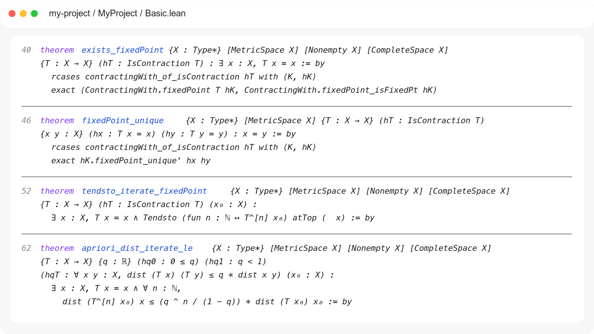
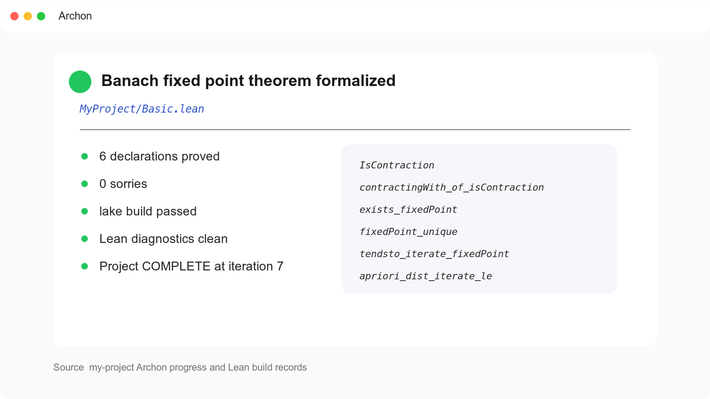

# 用 Archon 形式化巴拿赫不动点定理

这里演示一次完整的 Archon 形式化过程。假定已经通过 `archon-helper` 完成安装和配置，Archon 的安装路径也已经登记。在 OpenCode Desktop 中打开一个用于存放 Lean 代码的文件夹，新建对话，就可以把数学命题直接交给 Archon。

## 发出任务

在新对话中输入下面这段话。

```text
用 Archon 把下面的巴拿赫不动点定理形式化为 Lean 4。

设非空完备度量空间和自映射满足

$$
(X,d),\qquad T:X\to X.
$$

设实数 q 满足

$$
0\leq q<1,
$$

并且任意两点都有

$$
\forall x,y\in X,\qquad d(Tx,Ty)\leq q\,d(x,y).
$$

证明存在唯一的不动点

$$
\exists!\,x_*\in X\ \text{使得}\ T(x_*)=x_*.
$$

从任意初始点出发，递归定义迭代序列

$$
x_0\in X,\qquad x_{n+1}=T(x_n).
$$

证明这个序列收敛到该不动点，并给出误差估计

$$
x_n\xrightarrow[n\to\infty]{}x_*,\qquad
\forall n\in\mathbb{N},\qquad
d(x_n,x_*)\leq \frac{q^n}{1-q}d(Tx_0,x_0).
$$
```

`archon-helper` 会读取已经登记的 Archon 安装，并把当前工作区识别为这次形式化任务的项目。agent 会在首次调用模型前报告 provider 和 model，并请求用户确认。确认后，Archon 开始处理命题。当前文件夹需要初始化时，OpenCode 会说明即将创建的项目文件，并等待用户确认。

## Archon 如何完成形式化

Archon 会先整理命题和证明思路，写出一份带有依赖关系的证明蓝图。蓝图把主定理拆成若干可以分别处理的步骤，并记录各个步骤会用到的定义、引理和 Mathlib 结果。

在这个例子中，Archon 找到了 Mathlib 中处理压缩映射的 `ContractingWith`。它先用实数 q 定义题目中的压缩条件，再把这个条件转换成 Mathlib 使用的非负实数压缩常数。随后，Archon 调用现有的不动点、唯一性、迭代收敛和误差估计定理，完成 `Basic.lean` 中的证明。

随后，Archon 进入规划、证明和审查三个阶段。规划阶段确定 Lean 文件与待证明的定理。证明阶段负责完成代码，随后交给审查阶段核对代码和构建结果。构建中出现类型错误、缺失条件或尚未完成的证明时，相关意见会进入下一轮，Archon 再修改对应的 Lean 文件。

生成的 `Basic.lean` 包含不动点的存在性、唯一性、迭代收敛和误差估计。



每轮工作都会保存在当前项目中。OpenCode 会在对话里持续汇报当前阶段、修改过的 Lean 文件和构建结果。中途关闭对话以后，Archon 也可以根据项目里保存的进度继续运行。

`lake build` 通过以后，`Basic.lean` 中的 Lean 声明和证明项已经完成内核检查。原数学命题与这些声明的对应关系可以结合定理签名继续核对。Archon 会给出最终定理所在的文件、使用的主要引理以及构建结论。



## 阅读结果并继续讨论

形式化结束后，OpenCode 会展示最终 Lean 文件和构建结果。用户可以直接打开代码，也可以让 Archon 把 Lean 证明重新解释成通常的数学语言。

需要理解代码与数学证明之间的对应关系时，可以接着问。

```text
请解释最终 Lean 证明使用了哪些 Mathlib 定理，并说明它们分别对应原证明中的哪一步。
```

在同一个项目中新建对话以后，也可以用一句简短的话查看进度或继续工作。

```text
用 Archon 查看当前项目的形式化结果。
```

`archon-helper` 会按照已经登记的安装路径找到 Archon，再读取当前项目保存的进度、Lean 文件和构建结果。打开另一个项目时，同一套 Archon 安装也可以继续使用，新的工作区会成为下一次形式化任务的项目。
