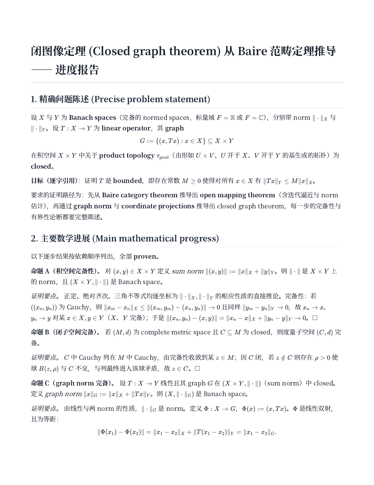
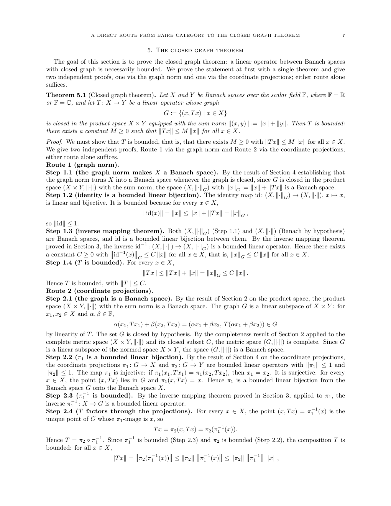

# 用 Danus 研究闭图像定理

这里记录一次完整的 Danus 数学研究流程。安装可以通过 OpenCode Desktop 中的
`danus-helper` 完成，也可以通过 DeepSeek Harness 中的 `danus-helper-dsh` 完成。
两个版本都按照下面的研究结构工作，并生成事实图、进展总结和论文等同类产物。

## 发出问题

先在当前环境中调用对应的 Helper Skill。OpenCode Desktop 使用：

```text
使用 $danus-helper 找到已经登记的 Danus，我要开始一个新的研究项目。
```

DeepSeek Harness 使用：

```text
使用 $danus-helper-dsh 找到已经登记的 Danus，我要开始一个新的研究项目。
```

进入 Danus 后，输入一句简短的请求：

```text
用 Danus 研究闭图像定理，给出从 Baire 范畴定理到开映射定理，再到闭图像定理的
完整证明。
```

这次研究的目标可以写成：设

$$
X,\qquad Y
$$

是 Banach 空间，并设

$$
T:X\to Y
$$

是线性映射。它的图像

$$
\Gamma(T)=\{(x,Tx):x\in X\}
$$

在

$$
X\times Y
$$

中闭。证明该映射有界，即存在常数

$$
C>0,
$$

使得

$$
\lVert Tx\rVert_Y\leq C\lVert x\rVert_X
$$

对每个

$$
x\in X
$$

成立。

相应的 Helper Skill 会读取已登记的 Danus 安装。首次使用时，Danus 会询问语言、
worker 数量和费用提醒等偏好。第一次调用模型前，agent 会报告 provider 和 model，
并请求用户确认。

## Danus 如何组织研究

确认后，主 agent 会保存原始问题并建立一个研究项目。它先分析证明需要经过的主要
环节，再把任务分配给多个 workers。在这个例子中，研究通常涉及：

- 从 Baire 范畴定理推出开映射定理；
- 核对逐次逼近中球半径和常数的估计；
- 证明闭图像在乘积范数下完备；
- 研究第一坐标投影的连续性、双射性和逆映射；
- 将第一坐标投影的逆映射与第二坐标投影复合，得到原映射的有界性；
- 检查完备性、线性和闭图像条件分别出现在哪一步。

每个 worker 在独立的 agent 会话中工作，并把候选结论连同证明提交给验证 agent。
验证 agent 会检查假设、量词、常数估计和依赖关系。通过检查的结论进入事实图；需要
修订的结论会带着验证意见返回 worker。

主 agent 根据事实图更新研究策略。它能够保留多条证明路线，比较各自需要的引理，
并让新的 worker 继续使用已经验证的结果。当前研究界面会持续汇报研究规划、worker
进展、验证结果和后续安排。

## 长时间运行和定时汇报

workers 启动后，Danus 会为当前项目安排下一次检查。到达检查时间时，主 agent 会
读取新增事实、验证意见和 worker 状态，向用户汇报进展，再安排后续检查。OpenCode
使用会话定时任务，DeepSeek Harness 使用自身的调度功能。

workers 以独立进程运行。重新打开 Danus 项目并新建对话时，可以输入：

```text
用 Danus 查看闭图像定理项目的进度，并继续监控。
```

Danus 会读取原有项目、事实图、worker 记忆和日志，在当前对话中继续汇报。worker
进程异常结束或电脑重启后，还可以输入：

```text
请恢复 Danus 的闭图像定理项目，查看当前进度并继续研究。
```

相应 Skill 会检查服务与 worker 状态，恢复运行环境，并从现有事实图和下一轮任务
继续工作。

## 在研究过程中生成总结

证明尚在推进时，可以直接提出：

```text
请为闭图像定理项目生成一份中文进展总结。
```

Danus 会从已验证的事实图生成面向数学家的报告。报告包括问题陈述、已经完成的关键
引理、主要证明思路、当前障碍、研究过程和待完成步骤。输出包含 Markdown 文件和
排版后的 PDF，内容中使用通常的数学表述。

这项功能适合查看长时间任务的阶段成果，也适合把当前进度交给另一位研究者阅读。

下面是本次实际运行生成的中文进展总结首页。报告从原问题开始，列出事实图中通过
验证的主要数学进展。



## 确认结果

当事实图中已经形成完整证明时，主 agent 会展示候选目标事实和主要依赖链，请用户
判断它们是否回答了原问题。确认后，Danus 把选定事实登记为项目的最终目标。

本例的完整运行形成了 20 项已验证事实。论文流程从目标事实的依赖关系中选取 10 项
作为正文的主要支撑，并对成稿重新进行全文数学检查。

最终证明的主线如下。

1. Baire 范畴定理给出开映射定理；
2. 闭图像

   $$
   \Gamma(T)\subseteq X\times Y
   $$

   作为乘积空间的闭线性子空间是 Banach 空间；
3. 第一坐标投影

   $$
   \pi_X:\Gamma(T)\to X
   $$

   是连续线性双射；
4. 开映射定理说明逆映射

   $$
   \pi_X^{-1}:X\to\Gamma(T)
   $$

   连续；
5. 第二坐标投影

   $$
   \pi_Y:\Gamma(T)\to Y
   $$

   连续，并且

   $$
   T=\pi_Y\circ\pi_X^{-1};
   $$

6. 因此

   $$
   T
   $$

   连续且有界。

这条主线由事实图中的已验证引理支撑。用户也可以继续要求 Danus 展开 Baire 论证、
检查某个常数或比较另一种证明。

## 生成完整论文

确认目标事实后，可以输入：

```text
请根据闭图像定理项目中已经确认的结果生成一篇完整论文。
```

Danus 会从目标事实的依赖闭包选择写作材料。内容较长时，写作流程会先规划章节，再
分别生成各部分并组装为完整 LaTeX 文档。随后依次完成：

- LaTeX 编译；
- 参考文献检查；
- 引用来源核实；
- 全文数学验证；
- 根据检查意见修订。

结束后，Danus 会报告最终 `main.tex`、PDF、编译结果、引用检查结果和数学验证结论。
用户提供自己的论文作为写作示例时，Danus 还可以参考其章节组织和表达风格。

本例生成的 LaTeX 正文约 36 KB，编译后的 PDF 约 274 KB。论文数学验证结论为
正确，关键假设、开映射定理的使用和闭图像论证均通过检查。中文进展总结生成了 5 页
PDF，涵盖问题陈述、关键引理、证明主线和最终结论。

下面是论文中证明闭图像定理的一页。正文同时给出 graph norm 和 coordinate
projections 两条证明路线。



## 继续使用同一个项目

新建对话后，可以用简短请求继续工作：

```text
用 Danus 查看闭图像定理项目的最终结果。
```

```text
用 Danus 重新解释开映射定理中使用 Baire 范畴定理的步骤。
```

```text
用 Danus 为这个项目再生成一份英文总结。
```

`danus-helper` 或 `danus-helper-dsh` 会按照已登记的安装路径找到 Danus，再读取对应
项目的事实图、总结、论文和运行记录。同一套安装也可以同时保存其他数学研究项目。
