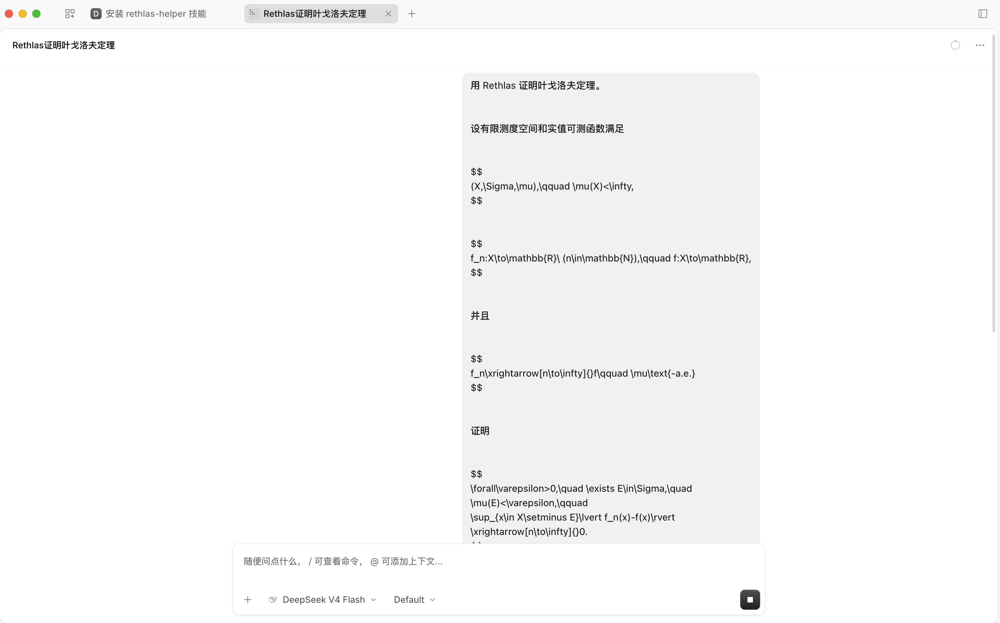
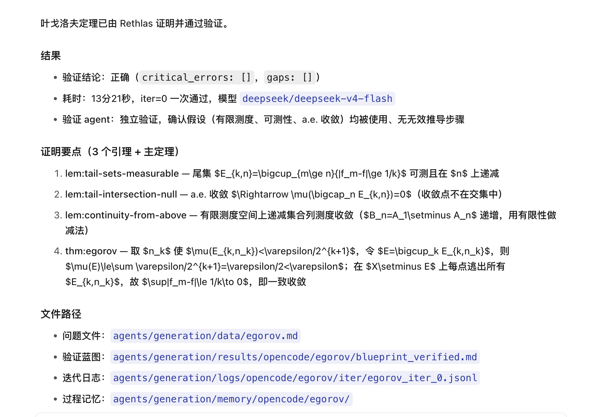

# 用 Rethlas 证明叶戈洛夫定理

这里演示一次完整的 Rethlas 解题过程。假定 Rethlas 已经在 OpenCode Desktop 中配置好。打开任意项目，新建一个对话，就可以像平时向数学同行提问一样，把题目直接交给它。

## 发出问题

在新对话中输入下面这段话。

```text
用 Rethlas 证明叶戈洛夫定理。

设有限测度空间和实值可测函数满足

$$
(X,\Sigma,\mu),\qquad \mu(X)<\infty,
$$

$$
f_n:X\to\mathbb{R}\ (n\in\mathbb{N}),\qquad f:X\to\mathbb{R},
$$

并且

$$
f_n\xrightarrow[n\to\infty]{}f\qquad \mu\text{-a.e.}
$$

证明

$$
\forall\varepsilon>0,\quad \exists E\in\Sigma,\quad
\mu(E)<\varepsilon,\qquad
\sup_{x\in X\setminus E}\lvert f_n(x)-f(x)\rvert
\xrightarrow[n\to\infty]{}0.
$$
```

Rethlas 会自行整理题目。agent 会在首次调用模型前报告本次使用的 provider 和 model，并请求用户确认。确认后，Rethlas 开始构造证明。



## Rethlas 如何完成证明

Rethlas 会先通读命题，确定需要使用的定义和定理，再写出一份按步骤展开的自然语言证明。随后，独立的验证 agent 会从头检查这份证明，逐项核对关键推导能否由题设得到，并检查量词、测度估计和一致收敛论证是否完整。

验证 agent 会把检查结果写成结构化意见。最终得到的是一份经过独立自动复核的自然语言证明蓝图。

验证意见会交回 Rethlas。证明中存在缺口时，Rethlas 会修改相应段落，再提交新版本接受检查。这样的修订可以进行多轮。验证 agent 给出通过结论时，Rethlas 保存最终证明；经过多轮修改仍有疑点时，它会说明剩下的问题。

OpenCode 会在当前对话中持续汇报生成、检查和修订进展。需要查看当前证明蓝图或某轮验证意见时，可以直接在对话中提出。

## 阅读和追问证明

检查结束后，Rethlas 会在当前对话中给出证明蓝图和检查结论。证明蓝图是一份可以直接阅读的自然语言证明。



需要展开某一步时，可以接着问。

```text
请展开证明中最关键的一步，并说明各项假设分别用在什么地方。
```

换一个项目或新建对话以后，也可以用一句简短的话查看这道题的结果。

```text
用 Rethlas 查看叶戈洛夫定理的证明结果。
```

Rethlas 会按照已经登记的安装路径查找这道题保存的结果，并重新展示最终版本和检查结论。
